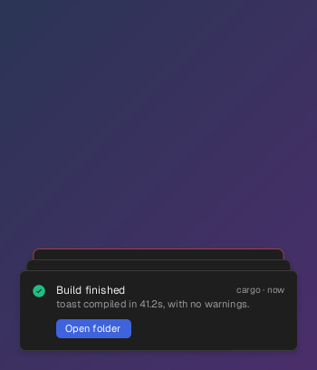
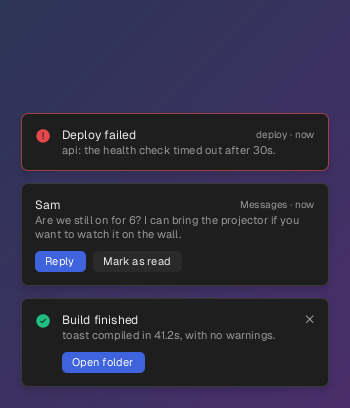
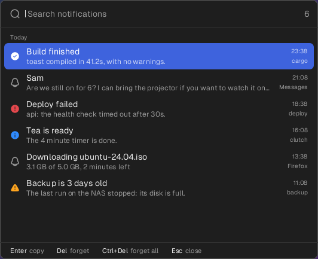

# toast

The desktop's notifications, drawn in a corner the way shadcn's toasts
are, kept in a history you can search, and sent from anywhere with a
line of shell. toast becomes the desktop's notification server, so
everything that notifies, from Firefox to `notify-send`, shows through
it. It works on X11, and on GNOME on Wayland.



```sh
toast send "Build finished" "toast compiled in 41.2s" --kind success --action "Open folder=xdg-open ."
```

## Install

```sh
cargo install --git https://github.com/jeffjose/toast
toast setup
```

`toast setup` writes `~/.config/toast/config.toml`, and has toast
started at login, and by D-Bus whenever anything is sent before then.
On XFCE it stops xfce4-notifyd and keeps it from starting again. On
GNOME it installs a small extension in the shell; log out and in once
for the shell to load it. `toast remove` undoes all of it.

## Use

```sh
toast send SUMMARY [BODY]   # send one (toast send --help for the options)
toast history               # the history, in a box to search
toast log                   # the last ones kept, here
toast quiet                 # show only critical ones; the rest are still kept
toast dismiss               # take them all off the screen
toast status                # what is running, and whether it has the notifications
```

The newest notification is in front, with the two before it peeking
out behind. With the pointer over them they are laid out in a column,
and none of them goes while it is there. A click on a notification does
what the program that sent it does on a click; a click on a button does
what the button says. The right button dismisses one, the middle button
all of them, and one can be swept off to the side.



### Sending

`toast send` can say anything a program can, and a few things more:

| | |
|---|---|
| `--kind success` | an icon and a color: `success`, `info`, `warning`, `error` |
| `--action "Open=xdg-open ."` | a button; with a command after `=`, toast runs it when clicked |
| `--click COMMAND` | run when the notification itself is clicked |
| `--wait` | wait for a button or a click, and print which: for scripts that ask |
| `--sticky` | stay until dismissed |
| `--where top` | show it somewhere else: `top-left`, `top`, `top-right`, `bottom-left`, `bottom`, `bottom-right` |
| `--progress 62` | a bar, 62 of 100 along; `--replace ID` with `--print-id` moves it on |
| `--quiet` | keep it in the history without showing it |

```sh
if [ "$(toast send 'Deploy to production?' --action Deploy --action Cancel --wait)" = deploy ]; then
    ./deploy
fi
```

Programs can ask for the same through the hints of an ordinary
notification: `x-toast-kind`, `x-toast-where`, `x-toast-sticky`,
`x-toast-quiet`, and `x-toast-run`, a line for each action of its key,
a tab and a command.

### The history



Every notification is kept, in `~/.local/state/toast/history`, a line of
JSON each, readable only by you. `toast history` opens it in a box in
the middle of the screen, as clutch's: type to narrow it, Enter copies
one, Delete forgets it, and Ctrl+Delete twice forgets everything. Bind
it to a key; with [clutch](https://github.com/jeffjose/clutch):

```toml
[bind]
"super+n" = "toast history"
```

`toast log` prints the last ones, and `toast log --json` prints them for
other programs.

## Settings

```toml
position = "bottom-right"   # where they show
seconds = 6                 # how long one stays; critical ones stay until dismissed
stack = 3                   # how many show at once
keep = 1000                 # how many the history keeps

[[rule]]                    # the first rule that matches has its say
app = "Spotify"
show = false                # kept, not shown

[[rule]]
summary = "*backup*"
sticky = true
position = "top"
```

A rule matches on `app`, `summary`, `body`, `category` and `urgency`,
where `*` matches anything and letters match either case. It can say
`show`, `sticky`, `seconds`, `position`, `kind` and `keep`. The file is
read again whenever a notification comes; `toast check` says what is
wrong with it.

## How it works

A notification server is any program that holds the session bus's
`org.freedesktop.Notifications` name; toast speaks the bus by hand, as
hotshot does, and draws with no toolkit, as clutch and jog do: Geist,
Solar's icons, and the same colors.

On X11 each corner's stack is a window that places itself over
everything and is cut to the shape of what is drawn in it, so the rest
of it can be clicked through. Where nothing on the desktop can see
through windows, what is behind one is drawn into it from a picture
taken as it opened, so that its edges, and a card fading, look right.

On Wayland a window cannot say where it goes. On GNOME toast's
extension in the shell puts each stack in its corner, over everything,
on every workspace, without giving it the keyboard, and keeps it out of
the window switcher. The shell keeps the notification name for itself,
so the extension takes over from the shell's own handling of
notifications and hands each one to toast; if toast cannot be reached,
the shell shows it as it always did. Notifications the shell makes
itself, and those GNOME's own apps send it directly, it still shows.

Other Wayland desktops are not supported yet.

## License

MIT
